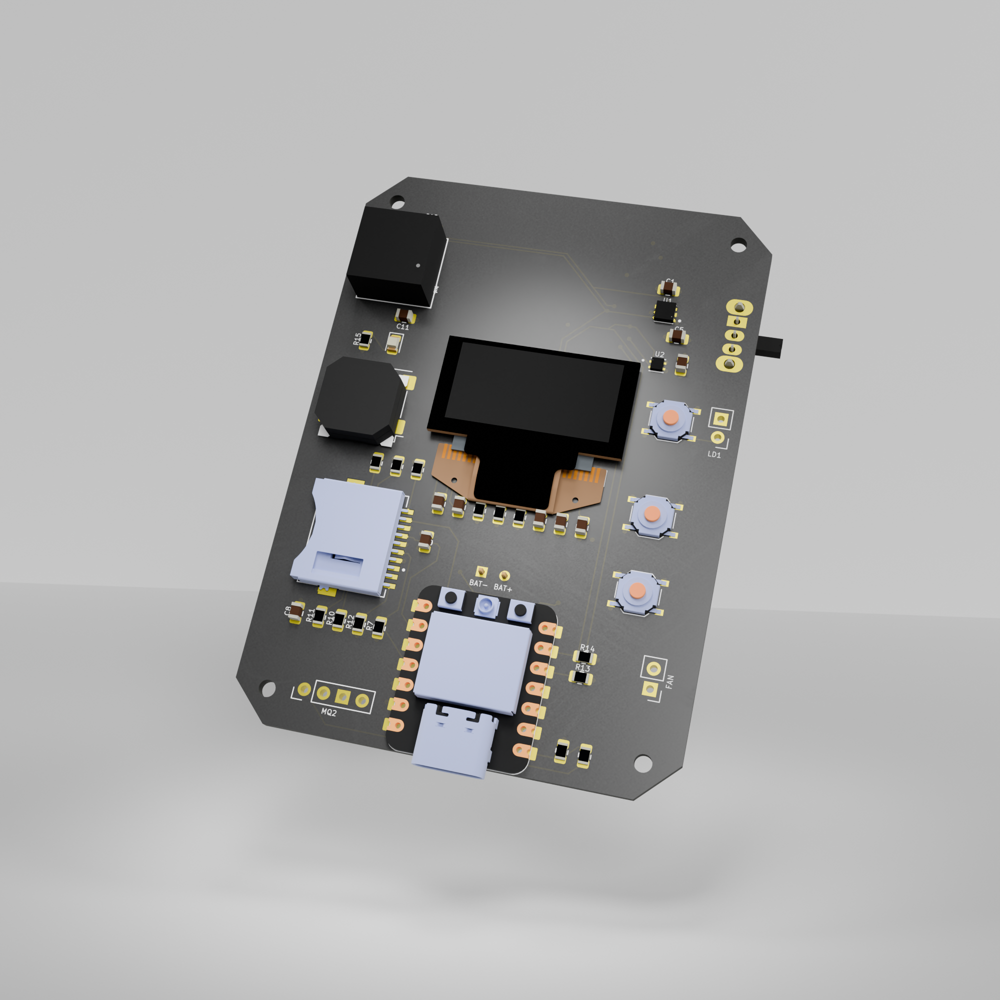
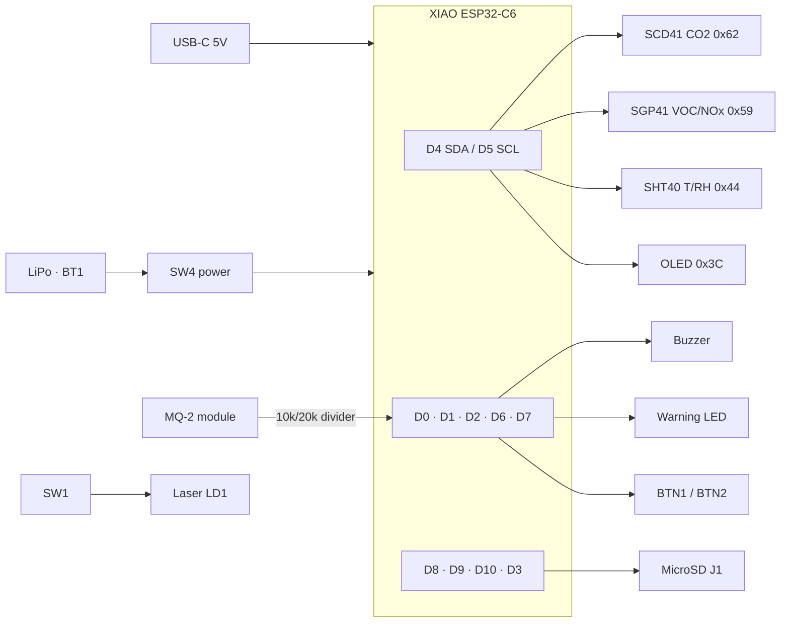
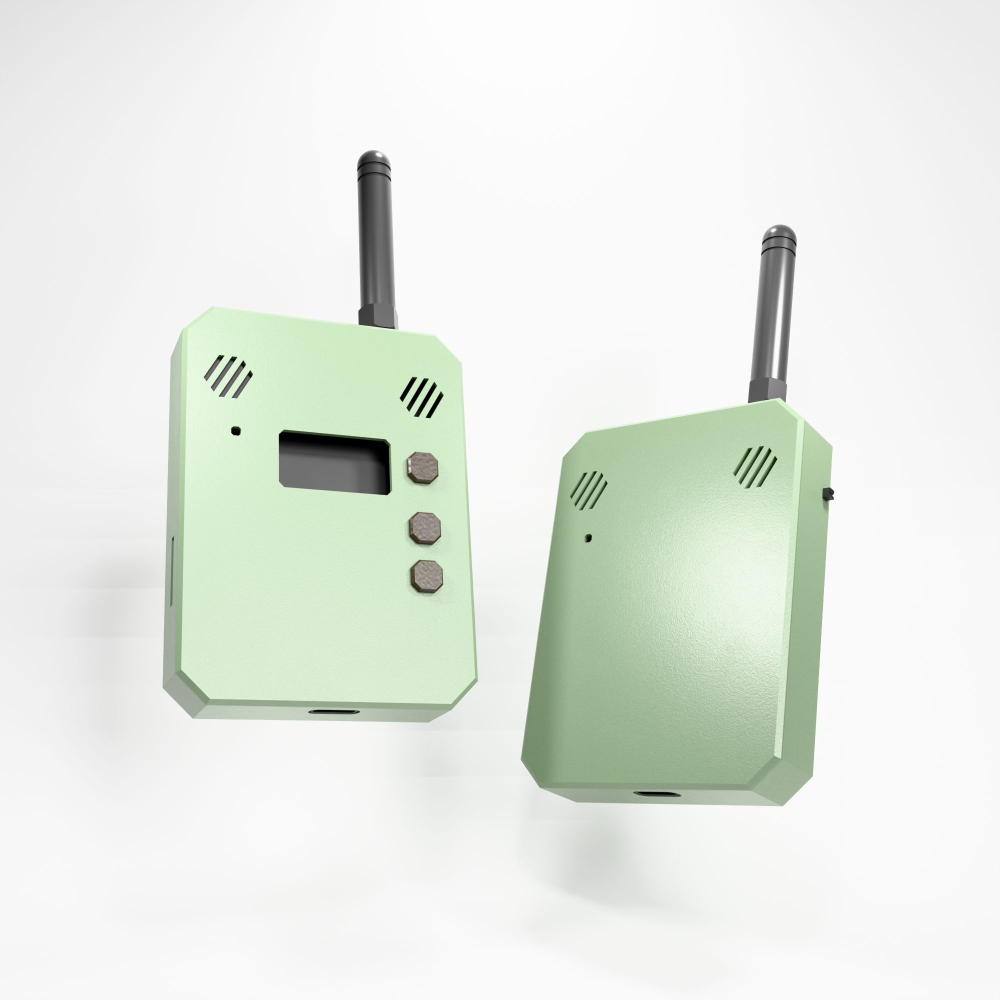

# KUTSU 1.0 — Hardware

[← KUTSU 1.0](README.md) · [Firmware →](KutsuFirmwareXIAOESP32C6/README.md)

The **Kutsu 1 board, rev 3**: a single 4-layer PCB that carries the MCU, the full Sensirion
sensor stack, the display, the MicroSD socket and the user controls. Units ship
**pre-soldered and enclosed**, ready to power on.

---

## Board at a glance

| | |
|---|---|
| **Title / revision** | Kutsu 1 · rev 3 (2026-09-22) |
| **EDA tool** | KiCad 10 |
| **Size** | 56.9 × 78.7 mm |
| **Layers** | 4 (F.Cu · In1.Cu · In2.Cu · B.Cu), 1.6 mm |
| **MCU** | Seeed **XIAO ESP32-C6** (RISC-V, Wi-Fi 6 2.4 GHz, BLE 5, USB-C, LiPo charger) |
| **Sensor bus** | One shared I²C bus: SCD41 `0x62` · SHT40 `0x44` · SGP41 `0x59` · OLED `0x3C` |
| **Storage** | MicroSD socket over SPI |
| **Power** | USB-C 5 V, or a LiPo cell on the battery header with a slide power switch |

---

## Bill of materials

### Active parts and modules

| Ref | Part | Function |
|---|---|---|
| U4 | **Seeed XIAO ESP32-C6** *(symbol reads `XIAO-ESP32-C5-SMD`; same footprint)* | Microcontroller + radios |
| U3 | **Sensirion SCD41-D-R2** | True NDIR CO₂ (+ T/RH) |
| U1 | **Sensirion SGP41-D-R4** | VOC + NOx raw signals → gas indices |
| U2 | **Sensirion SHT40-AD1B-R3** | Precision temperature + humidity |
| DS1 | **0.96" 128×64 OLED panel** (OLED-128O064D, SSD1306-class, I²C mode) | Display |
| BZ1 | Magnetic SMT buzzer (PUI SMT-1028-T-2-R) | Audible alarm |
| D1 | LED (0805) | Severity / warning indicator |
| LD1 | Laser diode | Point-of-interest marker |
| J1 | CUI **MSD-11-A** MicroSD socket | Data logging |

### Controls and connectors

| Ref | Part | Function |
|---|---|---|
| SW2 | Tactile push button | **BTN1**: cycle screens / dismiss alarm |
| SW3 | Tactile push button | **BTN2**: reserved |
| SW1 | Tactile push button | **Laser**: switches 3V3 straight to LD1 (no firmware involvement) |
| SW4 | SPDT slide switch (C&K OS102011MA1Q) | Power on/off |
| BT1 | 2-pin header | LiPo battery |
| MQ2 | 4-pin header: AO · (n/c) · GND · 5V | Optional external MQ-2 gas/smoke module |
| FAN | 2-pin header on the **5 V** rail | Airflow fan |

### Passives

| Ref | Value | Purpose |
|---|---|---|
| R2 / R1 | 10 kΩ / 20 kΩ | MQ-2 analog divider: 5 V output scaled to ≈ 3.3 V for the ADC |
| R5 | 390 kΩ | OLED panel IREF (segment current reference) |
| R13 / R14 | 4.7 kΩ | I²C SDA / SCL pull-ups to 3V3 |
| R6–R11 | 4.7 kΩ | MicroSD line pull-ups (CLK, MOSI, MISO, CS, DAT1, DAT2) |
| R12 | 4.7 kΩ | MicroSD card-detect pull-up |
| R15 | 4.7 kΩ | Warning-LED series resistor |
| R3 / R4 | 4.7 kΩ | Spare / auxiliary pull-ups |
| C1–C12 | 0.1 µF – 10 µF (0805) | Decoupling + OLED charge-pump capacitors |

---

## Pin map

The table below was checked against the rev 3 PCB nets. The XIAO pad labels (`D0`–`D10`) are
identical across the C3, C5 and C6 modules.

| XIAO pad | C6 GPIO | Net | Function |
|---|---|---|---|
| D0 | GPIO0 | `MQ2AO` | MQ-2 analog (through the R2/R1 divider). *Not yet read by firmware* |
| D1 | GPIO1 | `D1` | Warning LED (active-high) |
| D2 | GPIO2 | `GPIO4` | Buzzer |
| D3 | GPIO21 | `SDCS` | MicroSD CS |
| D4 | GPIO22 | `SDA` | I²C data |
| D5 | GPIO23 | `SCL` | I²C clock |
| D6 | GPIO16 | `BTN1` | Button 1 (active-low, internal pull-up) |
| D7 | GPIO17 | `BTN2` | Button 2 (active-low, internal pull-up) |
| D8 | GPIO19 | `SDCLK` | MicroSD SCK |
| D9 | GPIO20 | `SDSO` | MicroSD MISO |
| D10 | GPIO18 | `SDSI` | MicroSD MOSI |
| 3V3 / GND / 5V | — | `+3V3` / `GND` / `5V` | Power rails |
| BAT pads (underside) | — | `BATTERY` | LiPo + charger |
| *(internal)* | GPIO3 | — | **RF-switch enable**: drive LOW to power the C6 RF switch |
| *(internal)* | GPIO14 | — | **Antenna select**: LOW = on-board, HIGH = external u.FL |

> [!TIP]
> On the C6, D8 and D9 are **not** strapping pins (unlike the C3), so the MicroSD card can't
> block boot on this board.

---

## Block diagram

---

## Power

| Source | Use |
|---|---|
| **USB-C** (on the XIAO) | Powers the board at 5 V and charges a connected LiPo |
| **LiPo on BT1** | Handheld, untethered use; switched by SW4 |
| **Continuous 5 V** | Stationary use: needed for the **MQ-2** heater (~150 mA) and a **5 V fan** |

The FAN and MQ2 headers both sit on the `5V` rail, which is only present when USB-C is connected.

> [!IMPORTANT]
> The MQ-2 heater draws about 150 mA at 5 V, which is too much for battery operation. Fit the
> MQ-2 only in the Stationary configuration.

---

## Enclosure

The enclosure (see `Case/Kutsu 1 Case.blend`) has a display window, three front buttons, side
vents, a USB-C port and an **external whip antenna**. When you fit the external antenna, set
`RF_USE_EXTERNAL_ANT 1` in the firmware's `config.h`.

---

## Design files

| File | Purpose |
|---|---|
| `kutsu-10-xiao-esp32c5c3.kicad_pro` | KiCad project |
| `kutsu-10-xiao-esp32c5c3.kicad_sch` | Schematic, **rev 3** (authoritative) |
| `kutsu-10-xiao-esp32c5c3.kicad_pcb` | PCB layout, 4-layer |
| `kutsu-10-xiao-esp32c5c6.net` | Netlist. **Stale:** it's the rev 2 export (identical to the Handheld netlist) |
| `KUTSUV1 Gerber/`, `KUTSUV1 Gerber.zip` | Fabrication outputs: copper (4 layers), mask, paste, silk, edge cuts, PTH/NPTH drill, job file |
| `3D/kutsu-board-*.stl` / `.glb` | 3D board models |
| `Case/Kutsu 1 Case.blend` | Enclosure model (Blender) |

> [!NOTE]
> The project files are named `…c5c3` / `…c5c6` and the MCU symbol reads `XIAO-ESP32-C5-SMD`.
> That naming is historical. The fitted module is the **XIAO ESP32-C6**, which has an
> identical pad layout.

### Ordering PCBs

Upload `KUTSUV1 Gerber.zip` to your PCB fab and choose **4 layers, 1.6 mm**. The job file
(`*-job.gbrjob`) carries the stack-up and board-size metadata.

---

## Known hardware notes

- **OLED controller.** DS1 is treated as an SSD1306 at `0x3C`. If the display shows garbage,
  switch the firmware to an SH110X driver.
- **RF switch.** If Wi-Fi or BLE can't find anything, check that GPIO3 and GPIO14 are set
  correctly in `config.h`.
- **MQ-2 input (D0).** The divider is routed on the board, but the C6 firmware doesn't read
  the MQ-2 yet.
