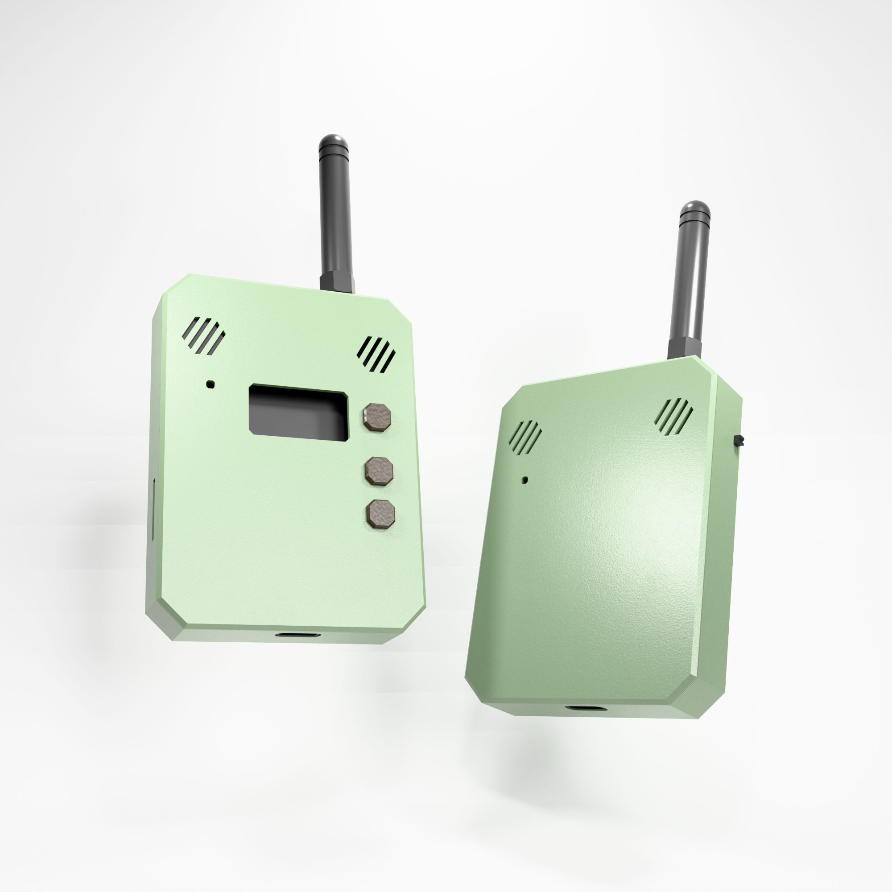
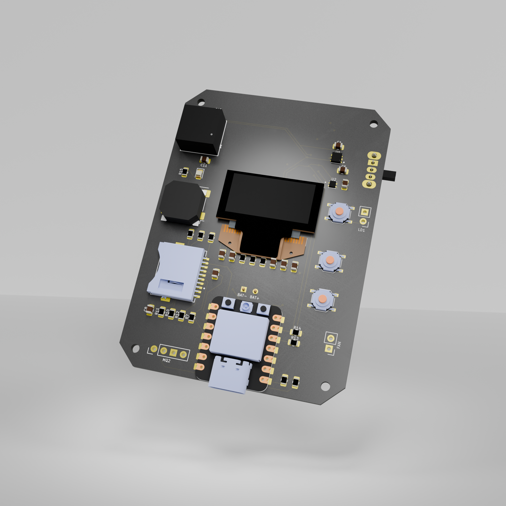

# KUTSU 1.0

> **One board, every use case.** KUTSU 1.0 merges the earlier Handheld and Stationary
> prototypes into a single PCB: the **Kutsu 1 board (rev 3)**. It's built around a Seeed XIAO
> ESP32 module (**C3, C5, C6 or S3**, same footprint, one firmware) and a
> laboratory-calibrated Sensirion sensor stack.

[← Back to project overview](../README.md)

  
  

---

## 📚 Documentation

| Document | What's inside |
|---|---|
| **[HARDWARE.md](HARDWARE.md)** | Board overview, bill of materials, pin map, power, design files, fabrication |
| **[Firmware README](KutsuFirmwareXIAOESP32Series/README.md)** | Arduino IDE setup per XIAO module, libraries, wiring, stationary mode + hub, bring-up checklist |
| **[KUTSU Hub](KutsuHub/README.md)** | The LAN dashboard + data collector for stationary units. Runs on a Raspberry Pi or an old Windows PC |
| **[FIRMWARE.md](KutsuFirmwareXIAOESP32Series/FIRMWARE.md)** | Firmware internals: sensor detection, tasks, Wi-Fi state machine, UI, logging, known issues |
| **[DATA_CONTRACT.md](KutsuFirmwareXIAOESP32Series/DATA_CONTRACT.md)** | JSON-Lines record format used by the log, BLE and the KUTSU Hub |
| **[Kutsu Setup app](KutsuSetupApp/)** | Local desktop app to set up a device's WiFi over **Bluetooth or USB** — no nRF Connect needed |
| **[PROVISIONING.md](PROVISIONING.md)** | The BLE GATT + USB-serial setup contract the app and firmware share |
| [kutsu-project.md](kutsu-project.md) | Short product description |

---

## What it measures

| Reading | Sensor | Type | Units |
|---|---|---|---|
| **CO₂** | Sensirion **SCD41** | Photoacoustic NDIR (true CO₂) | ppm |
| **VOC index** | Sensirion **SGP41** | MOx gas sensor + Gas Index Algorithm | 1–500 |
| **NOx index** | Sensirion **SGP41** | MOx gas sensor + Gas Index Algorithm | 1–500 |
| **Temperature** | Sensirion **SHT40** | Digital T/RH | °C |
| **Humidity** | Sensirion **SHT40** | Digital T/RH | %RH |
| **Combustible gas / smoke** | **MQ-2** *(optional, external module)* | Analog MOx | relative |

The firmware **detects its sensors at boot** with an I²C scan, then shows and logs only what it
finds. The original DIY breakouts still work on the same firmware: **CCS811** (eCO₂ + TVOC) and
**HTU21D** (temp/RH). So does a plug-in **SSD1306 OLED module** in place of the on-board panel.

**Why the upgrade matters:** the earlier builds used a CCS811, which *estimates* CO₂ from VOCs.
The SCD41 **measures** CO₂ directly. The SGP41 adds separate **VOC and NOx** indices, which
give a much richer picture than a single "air quality" number.

---

## The three configurations

All three use the **same Kutsu 1 board**. What changes is which parts are fitted, how the
board is powered, and which firmware features are enabled.

| Configuration | Power | Distinctive parts | Networking |
|---|---|---|---|
| 🛠️ **Development platform** | USB-C 5 V | I²C, SD, MQ-2 and power broken out to pads | Open firmware, full access |
| ✋ **Handheld** | LiPo battery (USB-C charging) | Compact, display-led UI, laser marker, small fan | Stays off Wi-Fi. Data via SD card, BLE app or USB |
| 🏠 **Stationary** | 5 V mains / USB | Optional **MQ-2** module, **5 V fan** | Joins Wi-Fi and feeds the **[KUTSU Hub](KutsuHub/README.md)** dashboard on a Pi / PC |

One design to manufacture, one firmware codebase and one data format: a handheld unit and a
wall-mounted site unit speak the same language.

**Handheld vs. stationary is now a software mode**, not just a hardware build — switch it from
the [Kutsu Setup app](KutsuSetupApp/) (Bluetooth/USB), the mobile app or the serial console,
and it persists. In **handheld** mode the unit works stand-alone and stays off Wi-Fi. In
**stationary** mode it joins Wi-Fi, finds the **[KUTSU Hub](KutsuHub/README.md)** (a small app
on a Raspberry Pi or PC on the same network) and streams its readings and log there. The hub
keeps the history and serves the site dashboard. A fresh device boots in handheld mode. See
[PROVISIONING.md](PROVISIONING.md) for the full behavior model and the settings
(buzzer / LED / display / scanning / mode) a connected client can change.

---

## Quick start

1. Install the **esp32 by Espressif** core (≥ 3.3) and select your module: **XIAO_ESP32C3**,
   **XIAO_ESP32C5**, **XIAO_ESP32C6** or **XIAO_ESP32S3**.
2. On C3/C5/C6, set **Partition Scheme → Huge APP (3MB No OTA/1MB SPIFFS)**. Leave **USB CDC On
   Boot → Enabled** (the default); see the
   [firmware README](KutsuFirmwareXIAOESP32Series/README.md#1-board-setup-arduino-ide).
3. Install the libraries listed in the [firmware README](KutsuFirmwareXIAOESP32Series/README.md#2-libraries).
4. Open `KutsuFirmwareXIAOESP32Series/KutsuSense/KutsuSense.ino` and upload.
5. Open the Serial Monitor at **115200**. The I²C scan should list `0x3C 0x44 0x59 0x62`.
6. *(Optional, stationary use)* Start the **[KUTSU Hub](KutsuHub/README.md)** on a Pi or PC
   (`python3 kutsu_hub.py`). Then set the unit to **stationary** with Wi-Fi credentials, using
   the **[Kutsu Setup app](KutsuSetupApp/)** or the Serial Monitor (`mode stationary`,
   `ssid <network>`, `pass <password>`, `connect`). The unit finds the hub by itself. Open the
   address shown on the unit's **Hub** screen.

---

## On-device experience

- **Boot.** A splash screen ("KUTSU / 6th Sense / By Papathought") is followed by a self-test
  screen that shows OK/FAIL for each module.
- **Screens.** One button cycles through **Live → Stats (1-hour sparklines) → Wi-Fi networks →
  BLE devices → Hub** (hub address, sync state, Wi-Fi).
- **Alerts:**

  | Channel | Behaviour |
  |---|---|
  | 🖥️ Display | Full-screen WARNING that pulses (5 s on / 1 s gap) until you dismiss it |
  | 🔊 Buzzer | 3 short beeps once per alert; re-arms after the air recovers |
  | 💡 Warning LED | Solid on alert, slow blink on warning, off when clear |

- **Logging.** JSON Lines go to MicroSD (`/kutsu_log.jsonl`), with internal flash as the
  fallback. Format: [DATA_CONTRACT.md](KutsuFirmwareXIAOESP32Series/DATA_CONTRACT.md).
- **KUTSU Hub.** In stationary mode the unit streams to the hub on the LAN, which charts
  every unit's history, raises alerts and exports CSV.
- **Laser marker.** A hardware switch lights a laser so you can point at the spot you're sampling.

### Default thresholds

| Metric | Warning `!` | Alert `!!` |
|---|---|---|
| CO₂ (SCD41) | ≥ 1000 ppm | ≥ 2000 ppm |
| eCO₂ / TVOC (CCS811 breakout) | ≥ 900 ppm / ≥ 660 ppb | ≥ 2000 ppm / ≥ 3000 ppb |
| VOC index | ≥ 250 | ≥ 400 |
| NOx index | ≥ 20 | ≥ 150 |
| Temperature | 50–60 °C | < 0 °C or > 60 °C |
| Humidity | 25–30 % or 60–70 %RH | < 25 % or > 70 %RH |

> [!NOTE]
> The CO₂, VOC and NOx limits are **provisional**. Calibrate them on site. You can change any
> of them in `config.h`.

---

## Directory contents

| Path | Contents |
|---|---|
| `kutsu-10-xiao-esp32c5c3.kicad_pro` / `.kicad_sch` / `.kicad_pcb` | KiCad project: **Kutsu 1, rev 3** |
| `kutsu-10-xiao-esp32c5c6.net` | Exported netlist *(older, rev 2; see [HARDWARE.md](HARDWARE.md#design-files))* |
| `KUTSUV1 Gerber/` + `KUTSUV1 Gerber.zip` | Fabrication gerbers + drill files |
| `3D/` | PCB render, board models (`.stl`, `.glb`) |
| `Case/` | Enclosure model (`Kutsu 1 Case.blend`) + render |
| `Kutsu Handheld 3D Model.blend` | Industrial-design model |
| `KutsuFirmwareXIAOESP32Series/` | Firmware for this board (XIAO ESP32-C3 / C5 / C6 / S3) |
| `KutsuHub/` | KUTSU Hub: LAN collector + dashboard for stationary units (Python, Raspberry Pi / Windows) |
| `BOM/` | Bill of materials / compliance sheet + component datasheets |
| `*.kicad_prl`, `fp-info-cache`, `.history/` | KiCad local/editor state, not part of the design |

---

## Other hardware variants

The XIAO footprint is pin-identical across the C3, C5, C6 and S3, and this board's firmware
supports all four. The earlier boards and their firmware are still available:

| Variant | MCU | Sensors | Where |
|---|---|---|---|
| **KUTSU 1.0** *(this)* | XIAO ESP32-C3 / C5 / C6 / S3 | SCD41 · SGP41 · SHT40 (+ CCS811 · HTU21D · MQ-2 if fitted) | [`KutsuFirmwareXIAOESP32Series`](KutsuFirmwareXIAOESP32Series/) |
| DIY Handheld | XIAO ESP32-C3 / C5 | CCS811 · HTU21D · | [`KUTSU DIY/KUTSU Handheld`](../KUTSU%20DIY/KUTSU%20Handheld/README.md) |
| DIY Stationary | ESP32-C5-DevKitC-1 | CCS811 · HTU21D · MQ-2 · 3 LEDs | [`KUTSU DIY/KUTSU Stationary`](../KUTSU%20DIY/KUTSU%20Stationary/README.md) |

---

## Roadmap

- [x] Sensirion SCD41 / SGP41 / SHT40 driver migration
- [x] One firmware for XIAO ESP32-C3 / C5 / C6 / S3
- [x] Boot-time I²C detection: on-board Sensirion stack, DIY CCS811/HTU21D breakouts, OLED panel or module
- [x] JSON data contract, ported from the
      [Stationary firmware](../KUTSU%20DIY/KUTSU%20Stationary/Firmware/KutsuSense/README.md)
- [x] **[KUTSU Hub](KutsuHub/README.md)**: LAN collector + dashboard on a Raspberry Pi / PC. It
      replaces the ESP32-hosted dashboard and mesh election, with gap-free history after outages
- [ ] Hub → device settings (thresholds, names) from the dashboard
- [x] NTP time sync when online
- [x] BLE GATT provisioning service + **[Kutsu Setup app](KutsuSetupApp/)** (Bluetooth **or** USB
      WiFi setup from the desktop) — see [PROVISIONING.md](PROVISIONING.md)
- [ ] Hardware bring-up of the merged firmware on each XIAO module (incl. BLE server+scanner coexistence)
- [ ] Package Kutsu Setup as an installable Tauri/Electron app; add firmware info/OTA, FRC calibration, node naming
- [ ] Mobile companion app (React Native / Expo) on the same GATT contract
- [ ] SCD41 fresh-air forced-recalibration (FRC) workflow; on-site threshold tuning
- [ ] BLE bonding / pairing PIN before deploying where open provisioning isn't acceptable

---

## For industrial & site deployment

- **Calibrated measurements.** True CO₂ (NDIR), VOC and NOx indices, temperature and humidity
  come from Sensirion sensors, not estimated proxies.
- **Standalone or fleet.** Each node works on its own: display, LED, alarm and SD log. Put
  several on one Wi-Fi network with the KUTSU Hub running on a Raspberry Pi or spare PC, and
  you get a live site dashboard with full history. There's no cloud and nothing to install
  beyond Python.
- **Your data stays yours.** Logs go to a removable MicroSD card in an open format. There's no
  cloud, no account and no per-seat fee.
- **Resilient.** Every node logs locally whatever the network state, and a failed sensor is
  marked invalid rather than reported as zero.
- **Flexible power.** Run it from 5 V mains with an active fan for permanent installs, or from a
  battery for portable audits.

> [!WARNING]
> KUTSU is an air-quality **awareness** instrument. The MQ-2 reports a *relative* gas/smoke
> level. Do not rely on it as a certified smoke, CO or life-safety alarm.

---

*By Papathought.*
