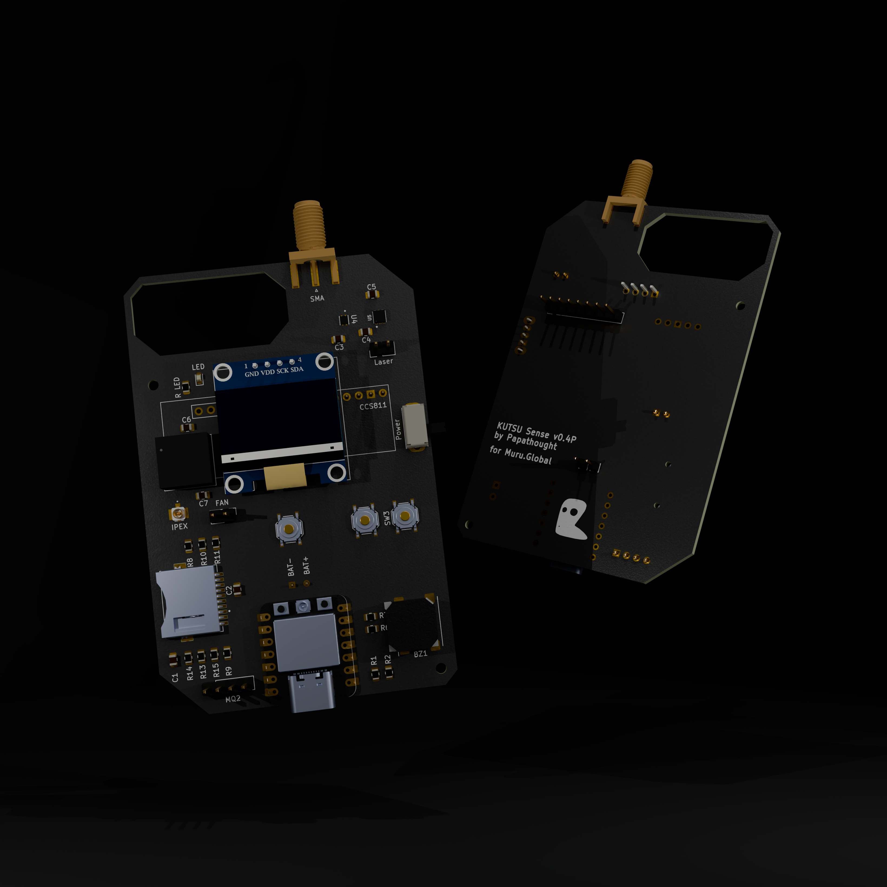

# KUTSU Handheld — Hardware

[← KUTSU Handheld](README.md) · [Firmware →](Firmware/README.md)

A 2-layer carrier board for a Seeed XIAO ESP32-C3/C5, silk-marked **"KUTSU Sense v0.4P · by
Papathought · for Muru.Global"**. Sensors plug in as breakout modules on headers, so the board
is easy to hand-solder.

---

## Board at a glance

| | |
|---|---|
| **Board revision** | v0.4P (schematic: "Kutsu Sense Board ESP32C5", rev 2) |
| **EDA tool** | KiCad 10 |
| **Size** | ≈ 60.7 × 91.9 mm |
| **Layers** | 2, 1.6 mm |
| **MCU** | Seeed **XIAO ESP32-C5** (or **XIAO ESP32-C3**, same footprint), through-hole or SMD |
| **Antenna** | Edge-mount **SMA** plus an **IPEX/u.FL** receptacle for an external antenna |
| **Power** | LiPo on **BAT+ / BAT−** pads, **Power** slide switch, USB-C charging via the XIAO |

---

## Bill of materials

### Modules and active parts

| Board label | Part | Interface | Notes |
|---|---|---|---|
| XIAO ESP32 | Seeed XIAO ESP32-C5 / C3 | — | MCU |
| `CCS811` | CCS811 eCO₂/TVOC breakout (8-pin header) | I²C `0x5A` | `WAK → GND` and `ADD → GND` are required |
| `HTU21D` | HTU21D-F temp/humidity breakout (5-pin header) | I²C `0x40` | |
| `0.96"` | DM-OLED096-636 / SSD1306 OLED module (4-pin: GND VDD SCK SDA) | I²C `0x3C` | |
| *(off-board)* | NT3H2111 NFC NTAG module | I²C `0x55` | Wire to the I²C bus |
| `J2` | CUI MSD-11-A MicroSD socket | SPI | On-board socket |
| `BZ1` | Magnetic buzzer (PUI SMT-1028 **or** Kobitone 254-EMB73 footprint) | GPIO | Active buzzer |
| `LED` + `R LED` | 0603 LED + series resistor | GPIO D1 | Spare indicator. The handheld firmware doesn't drive it |
| `Laser` | 2-pin header for a laser diode | — | Switched by SW3 |
| `MQ2` | 4-pin header (AO · n/c · GND · 5V) | Analog | Routed but **not used** on the handheld (power budget) |
| `FAN` | 2-pin header on the 5 V rail | — | Small fan |
| U4 / U5 / U6 | SHT40 / SGP41 / SCD41 footprints | I²C | **Unpopulated** on the DIY build. Forward-compatible with the [KUTSU 1.0 firmware](../../KUTSU%201.0/KutsuFirmwareXIAOESP32C6/README.md) |

### Controls

| Label | Net | Function |
|---|---|---|
| SW1 | `BTN1` → D6 | Cycle screens / dismiss alarm |
| SW2 | `BTN2` → D7 | Reserved |
| SW3 | 3V3 → `LASER` | Laser on while pressed (hardware only) |
| Power | `BATTERY` | Slide power switch |

### Passives

| Ref | Value | Purpose |
|---|---|---|
| R2 / R1 | 10 kΩ / 20 kΩ | MQ-2 analog divider (5 V → ≈ 3.3 V) |
| R6–R11, R13–R15 | 4.7 kΩ | I²C pull-ups and MicroSD line pull-ups |
| C1 | 10 µF | Bulk decoupling |
| C2–C7 | 0.1 µF | Local decoupling |

---

## Pin map (XIAO pads)

This map was verified against the PCB nets and matches `config.h` in both the C3 and C5
firmware.

| XIAO pad | Net | Function | C3 GPIO |
|---|---|---|---|
| D0 | `MQ2AO` | MQ-2 analog (unused on handheld) | 2 |
| D1 | `D1` | Spare LED | 3 |
| D2 | `GPIO4` | Buzzer (+) | 4 |
| D3 | `SDCS` | MicroSD CS | 5 |
| D4 | `SDA` | I²C data | 6 |
| D5 | `SCL` | I²C clock | 7 |
| D6 | `BTN1` | Button 1 (INPUT_PULLUP) | 21 |
| D7 | `BTN2` | Button 2 (INPUT_PULLUP) | 20 |
| D8 | `SDCLK` | MicroSD SCK | 8 ⚠️ strapping |
| D9 | `SDSO` | MicroSD MISO | 9 ⚠️ strapping |
| D10 | `SDSI` | MicroSD MOSI | 10 |
| 3V3 / GND / 5V | — | Power rails | — |
| BAT pads | `BATTERY` | LiPo | — |

**I²C bus:** OLED `0x3C` · HTU21D `0x40` · NTAG `0x55` · CCS811 `0x5A`

> [!WARNING]
> **ESP32-C3 only:** D8 and D9 are boot-strapping pins (GPIO9 is also the BOOT button). A
> MicroSD card can hold them at levels that block boot. If the board hangs, reset it with the
> card removed. The C5 doesn't have this problem.

---

## Wiring a hand-built unit

If you're building on perfboard instead of the PCB:

| Peripheral | Connection |
|---|---|
| Sensors / OLED / NFC power | VIN → **3V3**, GND → GND |
| I²C (HTU21D, OLED, NTAG, CCS811) | SDA → **D4**, SCL → **D5**, plus **4.7 kΩ pull-ups to 3V3** (the XIAO has none) |
| CCS811 extras | **WAK → GND** (required), ADD → GND |
| MicroSD (SPI) | SCK → **D8**, MISO → **D9**, MOSI → **D10**, CS → **D3** |
| Button 1 | **D6** ↔ GND |
| Button 2 | **D7** ↔ GND |
| Buzzer (active) | + → **D2**, − → GND |

All grounds are common.

---

## Power notes

- The LiPo connects to the XIAO's battery pads, and the XIAO charges it over USB-C.
- **The MQ-2 is omitted** because its heater draws ~150 mA at 5 V.
- The `FAN` and `MQ2` headers sit on the **5 V** rail, which is only live when USB-C is
  connected.

---

## Design files

| File | Purpose |
|---|---|
| `kutsu-board-xiao-esp32c5c3.kicad_pro` / `.kicad_sch` / `.kicad_pcb` | KiCad project |
| `kutsu-board-xiao-esp32c5c6.net` | Exported netlist |
| `kutsu-board-xiao-esp32c5c3.stl` / `.glb` | 3D board models |
| `Kutsu Handheld 3D Model.blend` | Enclosure / industrial-design model (Blender) |
| `KUTSU-Handheld-Test-Render.png` | Board render |
| `Kutsu Handheld Gerber 2208/` + `.zip` | **Current** fabrication files (exported 2026-08-22) |
| `Prod-02SA.zip` | Earlier production export (2026-08-04), kept for reference |
| `*.kicad_prl`, `fp-info-cache`, `.history/` | KiCad editor state, not part of the design |

> [!NOTE]
> The gerbers carry the base name `kutsu-board-esp32c5-devkitc-*`. That's an export-naming
> leftover: the files in `Kutsu Handheld Gerber 2208/` are the **Handheld** board (60.7 mm
> wide; the Stationary board is 60.25 mm).

### Ordering PCBs

Upload `Kutsu Handheld Gerber 2208.zip` to your PCB fab and choose **2 layers, 1.6 mm**.
