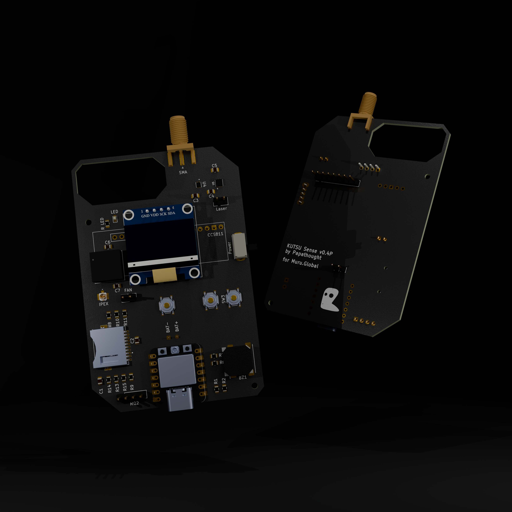

# KUTSU Handheld

> The **portable** KUTSU: a battery-powered, take-it-with-you air monitor. It reads eCO₂, TVOC,
> temperature and humidity, shows them on an OLED and sounds an alarm when conditions turn
> dangerous.

[← KUTSU DIY](../README.md) · [Project overview](../../README.md)

---

## 📚 Documentation

| Document | What's inside |
|---|---|
| **[HARDWARE.md](HARDWARE.md)** | Board v0.4P, bill of materials, wiring, power, fabrication files |
| **[Firmware/README.md](Firmware/README.md)** | Choosing between the XIAO ESP32-C3 and ESP32-C5 firmware |
| [C3 firmware setup](Firmware/KutsuFirmwareXIAOESP32C3/README.md) · [C3 internals](Firmware/KutsuFirmwareXIAOESP32C3/FIRMWARE.md) | XIAO ESP32-C3 (2.4 GHz) build |
| [C5 firmware setup](Firmware/KutsuFirmwareXIAOESP32C5/README.md) · [C5 internals](Firmware/KutsuFirmwareXIAOESP32C5/FIRMWARE.md) | XIAO ESP32-C5 (2.4 + 5 GHz) build |

---

## At a glance

| | |
|---|---|
| **MCU** | Seeed **XIAO ESP32-C5** or pin-compatible **XIAO ESP32-C3** |
| **Power** | Rechargeable **LiPo**, charged over the XIAO's USB-C |
| **Sensors** | **CCS811** (eCO₂ / TVOC) · **HTU21D** (temperature / humidity) |
| **Feedback** | 0.96" 128 × 64 OLED + active buzzer. The display is the primary interface |
| **Storage** | MicroSD (CSV), internal flash as fallback |
| **Extras** | Laser pointer · small 3 V fan |
| **Radios** | Passive Wi-Fi and BLE scanners on dedicated screens |

### Design choices

- **No MQ-2.** The MQ-2 is a 5 V part with a heater that draws ~150 mA, which the battery
  budget can't support. Air quality comes from the CCS811 only. The Stationary variant keeps
  the MQ-2.
- **Small fan.** You hold the handheld at a spot for a reading, so it only needs light airflow.
  Sustained room circulation is the Stationary unit's job.
- **Display-led UI.** The OLED and buzzer convey everything. There are no traffic-light LEDs
  and no on-board web server.

---

## Using it

1. **Power on.** A welcome screen ("KUTSU / 6th Sense / By Papathought") appears, then a
   boot-status screen showing OK or FAIL for each module.
2. **Read the live screen:** eCO₂, TVOC, Temp and Hum. A `!` marks a warning.
3. **Press the screen button** to cycle **Live → Stats (one-hour chart) → Wi-Fi networks →
   BLE devices → Live**.
4. **Alarm.** When any metric hits alert level, a full-screen WARNING pulses and the buzzer
   beeps 3 times. Press the button to dismiss it.
5. **Pull the SD card** to read `/kutsu_log.csv`, plus `/kutsu_net.csv` and `/kutsu_dev.csv`
   for the scan snapshots.

### Thresholds

| Shown as | Sensor | Unit | Warning `!` | Alert |
|---|---|---|---|---|
| `eCO2` | CCS811 | ppm | ≥ 900 | ≥ 2000 |
| `TVOC` | CCS811 | ppb | ≥ 660 | ≥ 3000 |
| `Temp` | HTU21D | °C | 50–60 | < 0 or > 60 |
| `Hum` | HTU21D | %RH | 25–30 / 60–70 | < 25 or > 70 |

---

## How it differs from the Stationary unit

| | Handheld | Stationary |
|---|---|---|
| Status LEDs | — | Green / yellow / red; can run headless |
| MQ-2 gas | — | ✅ |
| Web dashboard / mesh | — (BLE companion app planned) | ✅ |
| Log format | CSV | JSON Lines |
| Wi-Fi/BLE scan screens | ✅ | Removed in favour of outbound connectivity |

---

## Notes and open items

- **CCS811 run-in.** Readings of ~400 ppm eCO₂ and near-0 TVOC at rest are normal. The
  baseline needs ~20 min run-in and ~48 h burn-in.
- **No RTC.** Log timestamps are uptime seconds.
- **ESP32-C3 strapping pins.** D8 and D9 (SD SCK/MISO) are boot-strapping pins on the C3. If
  the board won't boot with a card inserted, reset it with the card removed.
- **Roadmap.** A BLE link to a companion app using the shared
  [JSON data contract](../KUTSU%20Stationary/Firmware/KutsuSense/DATA_CONTRACT.md).
