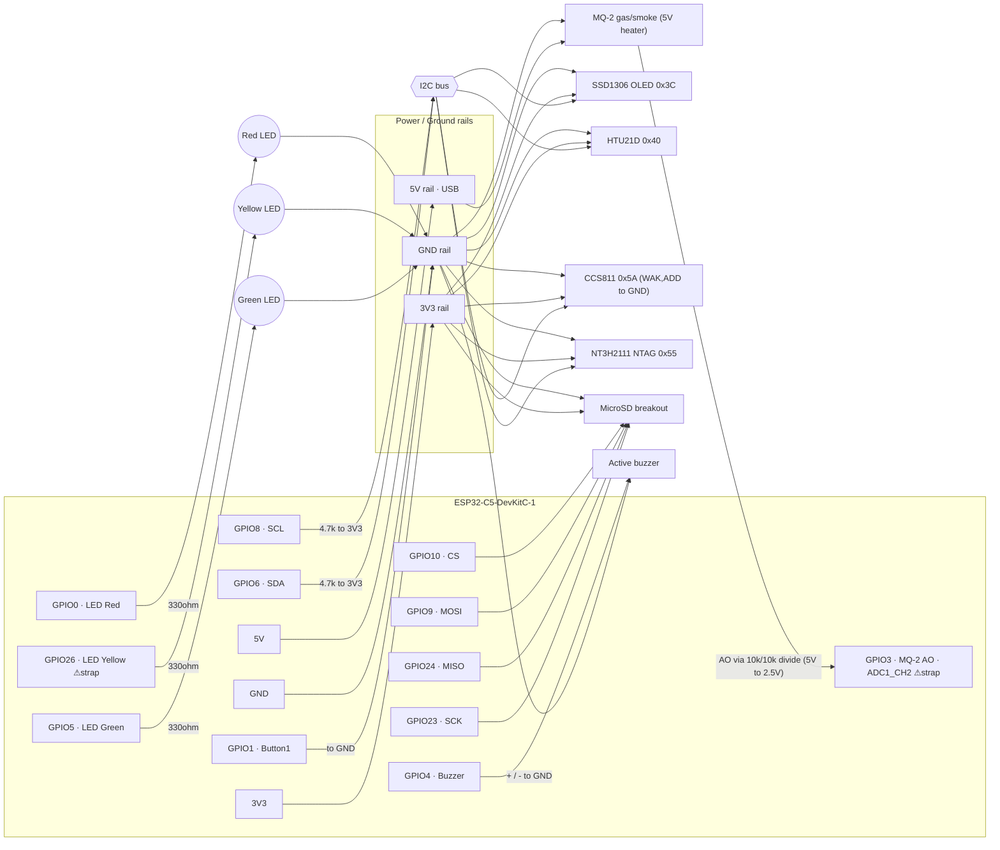

# KUTSU Sense — Wiring (ESP32-C5-DevKitC-1)

[← Stationary firmware](../README.md) · [Hardware](../../HARDWARE.md) · [Setup](README.md) · [Internals](FIRMWARE.md)

Wiring reference for the ESP32-C5-DevKitC-1 build, derived from `BOM.txt`.
Adds **3 status LEDs** (green / yellow / red) so a user with **no display** still
gets a clear visual indicator. Pins are the raw GPIO numbers used in `config.h`.

> **Board:** ESP32-C5-DevKitC-1 · powered from the **USB-C** port (5 V → onboard
> 3V3 regulator). Everything below runs on **3V3**; **all grounds common**.

## Bill of materials (from BOM.txt)

| Item | Role | Interface | I²C addr |
|---|---|---|---|
| ESP32-C5-DevKitC-1 | MCU | — | — |
| 0.96" SSD1306 OLED | Display | I²C | 0x3C |
| HTU21D-F | Temp + Humidity | I²C | 0x40 |
| CCS811 | eCO₂ + TVOC (air quality) | I²C | 0x5A |
| NT3H2111 NTAG (NFC) | Health record | I²C | 0x55 |
| Adafruit MicroSD breakout (#4682) | JSON Lines logging | SPI | — |
| Active buzzer (CPT-1206-3TH-T, 3 V) | Audible alarm | GPIO | — |
| **3 × LED diode (green/yellow/red)** | **Status indicator** | GPIO | — |
| MQ-2 gas & smoke module | Combustible gas | **5V** + analog | — |
| 2 × 4.7 kΩ resistor | I²C pull-ups | — | — |
| 3 × ~330 Ω resistor | LED current limit | — | — |
| 2 × 10 kΩ resistor | MQ-2 AO ÷2 divider | — | — |

> [!NOTE]
> This page describes a **breadboard / hand-wired** build. The v0.3S PCB uses a
> **10 kΩ / 20 kΩ** MQ-2 divider instead of 10 kΩ / 10 kΩ, so recalibrate the gas thresholds;
> see [HARDWARE.md](../../HARDWARE.md).

> **MQ-2 is wired and read by the firmware** (as a raw relative gas level on GPIO3,
> with a presence check). Two things make it different from every other part here:
> its heater is a **5 V** load (not 3V3) and its outputs swing to **~5 V**, which the
> C5's 3.3 V-only pins cannot take directly — so the analog output goes through a
> **÷2 divider** into GPIO3 (ADC1_CH2). The reported value is a **raw ADC level
> (0–4095), not calibrated ppm** — tune `GAS_WARN`/`GAS_HARM` in `config.h` to your
> sensor. An unpowered/unplugged sensor reads near 0 and shows `--`.

## Pin map (ESP32-C5-DevKitC-1)

All signal pins are clear of flash / USB / UART0 (per ESP32-C5 datasheet v1.3).
Two exceptions sit on strapping pins by necessity (see notes): the **yellow LED**
(GPIO26) and the **MQ-2 analog input** (GPIO3) — both chosen so the strap they
touch is harmless in this build.

| Peripheral | Signal | ESP32-C5 GPIO | Connect to | Notes |
|---|---|---|---|---|
| **I²C bus** (OLED, HTU21D, CCS811, NTAG) | SDA | **GPIO6** | each device SDA | + **4.7 kΩ pull-up → 3V3** |
| | SCL | **GPIO8** | each device SCL | + **4.7 kΩ pull-up → 3V3** |
| **CCS811 extras** | WAK | — | **GND** | **required**, or CCS811 won't init |
| | ADD | — | **GND** | sets addr 0x5A |
| **MicroSD** (SPI) | SCK | **GPIO23** | SD CLK | |
| | MISO | **GPIO24** | SD DO / MISO | |
| | MOSI | **GPIO9** | SD DI / MOSI | |
| | CS | **GPIO10** | SD CS | |
| **Button 1** (screen / dismiss) | — | **GPIO1** | one leg → GPIO1, other leg → **GND** | `INPUT_PULLUP`, active-low |
| **Button 2** (reserved) | — | *(GPIO25)* | **leave unwired** | strapping pin; unused in firmware |
| **Buzzer** (active) | + | **GPIO4** | buzzer +, − → **GND** | on/off, non-blocking 3-beep alarm |
| **LED — Green** (all good) | anode | **GPIO5** | → **330 Ω** → LED → **GND** | lit when every reading is good |
| **LED — Yellow** (warning `!`) | anode | **GPIO26** ⚠ | → **330 Ω** → LED → **GND** | lit when any metric is at warning · GPIO26 is a strapping pin (see note) |
| **LED — Red** (alert) | anode | **GPIO0** | → **330 Ω** → LED → **GND** | lit when any metric is at alert |
| **MQ-2** gas/smoke | VCC | **5V** | module VCC (heater ~150 mA) | ⚠ **5 V**, not 3V3 |
| | AO | **GPIO3** ⚠ | AO → 10 kΩ → GPIO3, and GPIO3 → 10 kΩ → GND | **÷2 divider mandatory** (AO ≈0–5 V → ≤2.5 V). GPIO3 = `ADC1_CH2` |
| | GND | **GND** | module GND | common |
| **Power** | 3V3 | **3V3** | OLED / HTU21D / CCS811 / NTAG / SD VCC | sensors/OLED/SD only |
| | GND | **GND** | all module grounds + button/LED/buzzer returns | single common ground |

### Why these pins (avoided pins)
- **Strapping (avoid):** GPIO2, 3, 7, 25, 26, 27, 28
- **Off-chip flash / PSRAM (unusable):** GPIO15–18, 20–22
- **Not broken out on the DevKitC-1 headers at all:** GPIO16–22 (so GPIO19 is *not available* on this board)
- **USB-Serial-JTAG (USB-C: flash + Serial Monitor):** GPIO13, 14
- **UART0 console:** GPIO11, 12
- GPIO4/GPIO5 are JTAG pins — perfectly fine as plain GPIO (only disables *hardware* JTAG; USB-Serial-JTAG debug still works).

> ⚠ **The strapping-pin signals.** After removing everything above, the DevKitC-1
> breaks out only **10 fully-safe GPIOs** (0, 1, 4, 5, 6, 8, 9, 10, 23, 24) — fewer
> than this build needs — so two signals sit on strapping pins, each chosen so the
> strap it touches is harmless here:
>
> - **Yellow LED → GPIO26.** An LED is only a weak output load: at reset the pin is
>   high-impedance and the LED+resistor to GND can't override the boot strap. (An
>   I²C pull-up or a button would be a stronger, riskier load — those stay on clean
>   pins.) Fallback: GPIO15 (no-PSRAM modules only) or a 2-LED build.
> - **MQ-2 analog → GPIO3.** GPIO3 is the only free ADC pin (`ADC1_CH2`) and its
>   strapping role (MTDI) sets just the **SDIO-slave clock edge** — an interface this
>   build never uses (the SD card runs over SPI, not SDIO). Whatever the divider
>   presents at reset only latches an SDIO bit we ignore, so it's safe. The ÷2
>   divider also gives ~5 kΩ series impedance (well within the ADC's source limit).

## Status-LED logic (the new feature)

> [!NOTE]
> This is the simplified wiring-level view. The firmware also has combined states (green +
> yellow for a warning, yellow-only when more than 3 metrics warn, blinking red for an alert,
> blinking yellow for a sensor error). [FIRMWARE.md §5](FIRMWARE.md#5-status-leds) is the
> authoritative description.

One LED at a time, driven by the **worst** severity across eCO₂ / TVOC / Temp / Humidity:

| LED | Condition | Meaning |
|---|---|---|
| 🟢 **Green** | all metrics good (sev 0) *and* at least one sensor valid | air/environment OK |
| 🟡 **Yellow** | any metric at **warning** `!` (sev 1) | approaching a limit |
| 🔴 **Red** | any metric at **alert** (sev 2) | harmful — matches the OLED alarm + buzzer |

If no sensor returns valid data, all three stay off (the firmware won't claim "good").
Thresholds live in `config.h` (eCO₂ 900/2000 ppm, TVOC 660/3000 ppb, Temp warn 50 / alert <0 or >60 °C, Humidity warn 30–60 / alert <25 or >70 %RH).

## Wiring diagram

## Bring-up checklist
1. Arduino IDE **Tools → Board → ESP32-C5 Dev Module** (or *ESP32-C5-DevKitC-1*); enable **USB CDC On Boot** so `Serial` works over USB-C.
2. Add the two **4.7 kΩ** I²C pull-ups, the three **330 Ω** LED resistors, and the **two 10 kΩ** MQ-2 divider resistors.
3. **CCS811 WAK → GND** (mandatory) and **ADD → GND**.
   **MQ-2: VCC → 5V** (never 3V3), and AO **must** go through the 10k/10k divider — never straight to GPIO3.
4. Power via USB-C, open **Serial Monitor @ 115200**. Boot prints an I²C scan — expect `found 0x3C / 0x40 / 0x55 / 0x5A`.
5. At power-on the three LEDs blink green→yellow→red once (self-test), then settle on the live status color.
6. **Verify on your board revision:** GPIO0 isn't tied to an onboard BOOT button; if `FSPI` is undefined at compile, switch `SPIClass spiSD(FSPI)` to `SPI`/`HSPI`.
