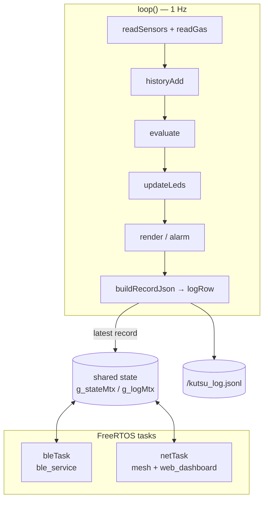

# KUTSU Stationary — Firmware

[← KUTSU Stationary](../README.md) · [Hardware](../HARDWARE.md)

Firmware for the **ESP32-C5-DevKitC-1 v1.2** Stationary node. This is the most connected KUTSU
build: it has a BLE app link, a self-electing Wi-Fi mesh, a self-hosted web dashboard and the
shared JSON data contract.

---

## Folders

| Folder | What it is |
|---|---|
| [**`KutsuSense/`**](KutsuSense/README.md) | **The production firmware** (Arduino / C++) |
| [`idf-flashtest/`](idf-flashtest/README.md) | A minimal **ESP-IDF** program that blinks the three status LEDs, to check that your toolchain can flash the C5 |

### `KutsuSense/` documents

| Document | What's inside |
|---|---|
| [README.md](KutsuSense/README.md) | Board setup, **flashing troubleshooting**, libraries, bring-up |
| [FIRMWARE.md](KutsuSense/FIRMWARE.md) | Architecture, status LEDs, UI, logging, connectivity internals |
| [WIRING.md](KutsuSense/WIRING.md) | Wiring table, pin-choice rationale, Mermaid diagram |
| [DATA_CONTRACT.md](KutsuSense/DATA_CONTRACT.md) | JSON record schema v2 |
| [BOM.txt](KutsuSense/BOM.txt) | Prototype bill of materials with supplier links |

---

## Source layout

```text
KutsuSense/
├── KutsuSense.ino      core: sensors, evaluate, LEDs, OLED UI, JSON logging, NFC, task startup
├── config.h            ALL tunables: pins, thresholds, LED logic, timings, NFC record
├── kutsu_link.h        the narrow interface the connectivity modules use to reach the core
├── identity.cpp/.h     MAC-derived device name   → "Kutsu-A1B2C3", host "kutsu-a1b2c3"
├── ble_service.cpp/.h  Kutsu Environmental Service: LIVE · TIMEGEO · WIFI · STATUS · HISTORY
├── mesh.cpp/.h         Wi-Fi join, mDNS _kutsu._tcp, master/slave election, ingest POST
├── web_dashboard.cpp/.h  synchronous WebServer: /, /api/nodes, /api/ingest
└── index_html.h        self-contained dashboard single-page app (served by the master)
```

---

## Runtime architecture



- The sensing loop never blocks on the network. Connectivity runs in its own FreeRTOS tasks
  and reaches the core only through `kutsu_link.h`, which is guarded by two mutexes.
- **One record format everywhere.** `buildRecordJson()` produces the string that's written to
  SD, notified over BLE and POSTed across the mesh.

---

## Quick start

1. Install **esp32 by Espressif ≥ 3.3.x** and select **ESP32C5 Dev Module**.
2. Use these settings: **USB CDC On Boot = Enabled**, **Upload Speed = 115200**,
   **Flash 4 MB / DIO / 40 MHz**, **Partition Scheme = Huge APP**.
3. Install the libraries: Adafruit **SSD1306**, **GFX**, **HTU21DF**, **CCS811**, **BusIO**, and
   **ArduinoJson v7**.
4. Plug into the DevKitC's native **"USB"** port, **unplug the MQ-2**, and upload.
5. Open the Serial Monitor at **115200**. The LEDs blink G → Y → R and the I²C scan shows
   `0x3C 0x40 0x55 0x5A`.

> [!WARNING]
> **Don't install or include NimBLE-Arduino** for this build. It crashes on the C5. Use the
> core's bundled `BLEDevice.h`. Also don't use ESPAsyncWebServer, which asserts on
> ESP-IDF 5.x; the dashboard uses the core's synchronous `WebServer`.

If the upload fails (`Invalid head of packet`, `Write timeout`, `flash_id`), follow the
[troubleshooting guide](KutsuSense/README.md#upload-fails-invalid-head-of-packet--failed-uploading-at-921600)
or flash with ESP-IDF using [`idf-flashtest`](idf-flashtest/README.md).

---

## Log format (JSON Lines)

Each sample is one line in `/kutsu_log.jsonl`:

```json
{"v":2,"id":"Kutsu-A1B2C3","role":"master","room":"Kitchen","up":1234,"ts":1719000000,
 "sev":1,"eco2":812,"tvoc":140,"temp":22.6,"hum":44.8,"gas":1503,"s_gas":1, "...": "..."}
```

The full schema is in [DATA_CONTRACT.md](KutsuSense/DATA_CONTRACT.md).
