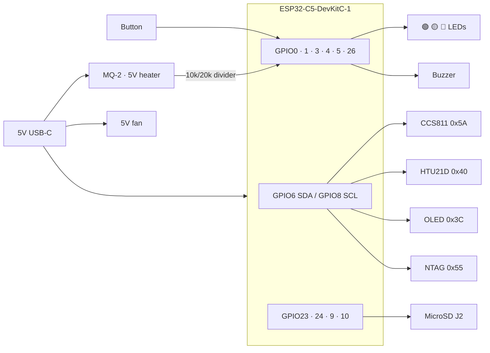

# KUTSU Stationary — Hardware

[← KUTSU Stationary](README.md) · [Firmware →](Firmware/README.md) · [Detailed wiring →](Firmware/KutsuSense/WIRING.md)

A 2-layer carrier board for the Espressif **ESP32-C5-DevKitC-1 v1.2**, silk-marked **"Kutsu 6th
Sense · by Papathought · muru.global · v0.3S 200826"**. The DevKitC plugs into two 1×16
headers. Sensors mount as breakout modules, and three status LEDs let the unit run without a
display.

---

## Board at a glance

| | |
|---|---|
| **Board revision** | v0.3S (schematic: "Kutsu Sense Board ESP32C5", rev 2) |
| **EDA tool** | KiCad 10 |
| **Size** | ≈ 60.3 × 91.9 mm |
| **Layers** | 2, 1.6 mm |
| **MCU** | ESP32-C5-DevKitC-1 v1.2 on 2 × 16-pin 2.54 mm headers |
| **Antenna** | DevKitC on-board PCB antenna |
| **Power** | 5 V through the DevKitC USB-C ("USB" or "UART" port) |

---

## Bill of materials

### Modules and active parts

| Board label | Part | Interface | Notes |
|---|---|---|---|
| *(headers)* | Espressif **ESP32-C5-DevKitC-1 v1.2** | — | MCU, dual-band Wi-Fi 6 + BLE 5 |
| `CCS811` | CCS811 eCO₂/TVOC breakout (8-pin header) | I²C `0x5A` | `WAK → GND` and `ADD → GND` are required |
| `HTU21D` | HTU21D-F temp/humidity breakout (5-pin header) | I²C `0x40` | |
| `0.96"` | DM-OLED096-636 / SSD1306 OLED module | I²C `0x3C` | **Optional** |
| *(off-board)* | NT3H2111 NFC NTAG module | I²C `0x55` | Wire to the I²C bus |
| `J2` | CUI MSD-11-A MicroSD socket | SPI | On-board socket |
| `MQ2` | 4-pin header (AO · n/c · GND · 5V) for an MQ-2 module | Analog | Through the R2/R1 divider to GPIO3 |
| `BZ1` | Magnetic buzzer (PUI SMT-1028 or Kobitone 254-EMB73 footprint) | GPIO4 | Active buzzer |
| `GRN` / `YLW` / `RED` | 0603 status LEDs + series resistors | GPIO5 / 26 / 0 | Active-high |
| `FAN` | 2-pin header on the 5 V rail | — | 5 V fan |
| U3 / U4 / U5 | SCD41 / SHT40 / SGP41 footprints | I²C | **Unpopulated** on the DIY build (forward-compatible) |
| *(off-board)* | Push button | GPIO1 ↔ GND | Screen / dismiss. Routed to the header, no on-board footprint |

### Passives

| Ref | Value | Purpose |
|---|---|---|
| R2 / R1 | 10 kΩ / 20 kΩ | MQ-2 AO divider (5 V → ≈ 3.3 V) |
| R3–R11, R13–R15 | 4.7 kΩ | I²C pull-ups, MicroSD line pull-ups, LED series resistors |
| C1 | 10 µF | Bulk decoupling |
| C2–C7 | 0.1 µF | Local decoupling |

> [!IMPORTANT]
> **MQ-2 divider differs between PCB and breadboard.** The v0.3S PCB uses **R2 = 10 kΩ /
> R1 = 20 kΩ** (×⅔, so 5 V reads as ≈ 3.3 V). The breadboard wiring in
> [WIRING.md](Firmware/KutsuSense/WIRING.md) uses **10 kΩ / 10 kΩ** (÷2). On the PCB, raw gas
> readings come out about 33% higher, so recalibrate `GAS_WARN`, `GAS_HARM` and
> `GAS_PRESENT_MIN` in `config.h` for whichever divider you build.

The original prototype BOM (with supplier links) is in
[`Firmware/KutsuSense/BOM.txt`](Firmware/KutsuSense/BOM.txt).

---

## Pin map (raw GPIO)

The DevKitC has no `D0…D10` macros, so the firmware uses raw GPIO numbers. This map was checked
against the PCB header nets.

| Function | GPIO | Net | Notes |
|---|---|---|---|
| I²C SDA | **6** | `SDA` | 4.7 kΩ pull-up to 3V3 |
| I²C SCL | **8** | `SCL` | 4.7 kΩ pull-up to 3V3 |
| MicroSD SCK | **23** | `SDCLK` | |
| MicroSD MISO | **24** | `SDSO` | |
| MicroSD MOSI | **9** | `SDSI` | |
| MicroSD CS | **10** | `SDCS` | |
| Button 1 | **1** | `GPIO1` | INPUT_PULLUP, to GND |
| Buzzer | **4** | `GPIO4` | Active buzzer (+) |
| LED green | **5** | `GPIO5GREEN` | |
| LED yellow | **26** ⚠️ | `GPIO26YELLOW` | Strapping pin, but safe as a weak output |
| LED red | **0** | `GPIO0RED` | Check that your board doesn't tie GPIO0 to BOOT |
| MQ-2 analog | **3** ⚠️ | `MQ2AO` | ADC1_CH2. Its strap only sets the unused SDIO clock edge |
| Power | 3V3 / 5V / GND | | |

> [!NOTE]
> **Why two strapping pins?** After you exclude flash/PSRAM (GPIO15–18, 20–22), USB (13/14)
> and UART0 (11/12), the DevKitC-1 exposes only **10 fully-safe GPIOs**, and this build needs
> 11 signals. The full reasoning is in [WIRING.md](Firmware/KutsuSense/WIRING.md#why-these-pins-avoided-pins).

---

## Block diagram

---

## Power

| Load | Rail | Notes |
|---|---|---|
| Sensors, OLED, NFC, SD | 3V3 (DevKitC regulator) | |
| **MQ-2 heater** | **5 V** | ~150 mA. **Never power it from 3V3** |
| **Fan** | 5 V | Active room-air circulation |

> [!TIP]
> **Unplug the MQ-2 while flashing.** Its heater inrush can brown out the board when it's
> powered from USB, and that breaks the upload.

---

## Design files

| File | Purpose |
|---|---|
| `kutsu-board-esp32c5-devkitc.kicad_pro` / `.kicad_sch` / `.kicad_pcb` | KiCad project |
| `kutsu-board-esp32c5-devkitc.net` | Exported netlist |
| `kutsu-board-esp32c5-devkitc-test.stl` / `.glb` | 3D board models |
| `Kutsu Stationary 3D Model.blend` | Enclosure / industrial-design model (Blender) |
| `KUTSU-Stationary-test-render.png` | Board render |
| `Kutsu Stationary Gerber 2208/` + `.zip` | **Current** fabrication files (exported 2026-08-22) |
| `Prod-02SA.zip` | Earlier production export (2026-08-04), kept for reference |
| `*.kicad_prl`, `fp-info-cache` | KiCad editor state, not part of the design |

### Ordering PCBs

Upload `Kutsu Stationary Gerber 2208.zip` to your PCB fab and choose **2 layers, 1.6 mm**.
