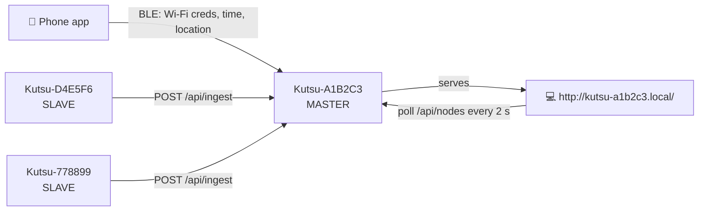

# KUTSU Stationary

> The **fixed-install** KUTSU: a 5 V-powered air monitor that sits in a room and watches it
> continuously. Several units link into a self-hosted **Wi-Fi mesh with a web dashboard**, so
> every room is visible from one page.

[← KUTSU DIY](../README.md) · [Project overview](../../README.md)

---

## 📚 Documentation

| Document | What's inside |
|---|---|
| **[HARDWARE.md](HARDWARE.md)** | Board v0.3S, bill of materials, pin map, power, fabrication files |
| **[Firmware/README.md](Firmware/README.md)** | Firmware overview and how to flash the ESP32-C5 |
| [KutsuSense/README.md](Firmware/KutsuSense/README.md) | Arduino setup, flashing troubleshooting, libraries, bring-up |
| [KutsuSense/FIRMWARE.md](Firmware/KutsuSense/FIRMWARE.md) | Firmware internals: LEDs, UI, logging, BLE, mesh, dashboard |
| [KutsuSense/WIRING.md](Firmware/KutsuSense/WIRING.md) | Full wiring table, pin rationale, Mermaid wiring diagram |
| [KutsuSense/DATA_CONTRACT.md](Firmware/KutsuSense/DATA_CONTRACT.md) | JSON record schema (v2) shared by SD, BLE and Wi-Fi |
| [idf-flashtest/README.md](Firmware/idf-flashtest/README.md) | ESP-IDF LED-blink test for checking the toolchain |

---

## At a glance

| | |
|---|---|
| **MCU** | Espressif **ESP32-C5-DevKitC-1 v1.2** (on-board PCB antenna, more exposed GPIO than a XIAO) |
| **Power** | **5 V** mains adapter or USB |
| **Sensors** | **CCS811** (eCO₂ / TVOC) · **HTU21D** (temperature / humidity) · **MQ-2** (combustible gas / smoke) |
| **Feedback** | OLED · buzzer · **three status LEDs** 🟢 🟡 🔴 |
| **Display** | **Optional:** the LEDs carry the status, so the unit can run headless |
| **Fan** | 5 V fan for proper room-air circulation |
| **Storage** | **JSON Lines** on MicroSD, flash fallback |
| **Connectivity** | **BLE app link** + **Wi-Fi master/slave mesh** + **web dashboard** |

---

## Status LEDs

| LEDs | Meaning |
|---|---|
| 🟢 Green solid | All good |
| 🟢 + 🟡 Green + yellow solid | A warning on up to 3 metrics |
| 🟡 Yellow solid (green off) | Warnings on **more than 3** metrics: conditions are sub-optimal |
| 🔴 Red blinking | **Alert.** Shown together with the OLED alarm and the buzzer |
| 🟡 Yellow blinking | A required sensor failed to start |

At power-on the LEDs blink green → yellow → red as a self-test. If several states apply at
once, the priority is **Alert > Error > Warning > Good**.

---

## Web dashboard and node mesh

1. **Provision over BLE.** The phone app writes the Wi-Fi SSID, password and room name, and
   the node stores them in NVS.
2. **The first node on the network becomes MASTER.** It finds no peer over mDNS
   (`_kutsu._tcp`), so it starts the web dashboard at `http://kutsu-<id>.local/`.
3. **Each later node becomes a SLAVE** and POSTs every sample to the master.
4. **The dashboard** shows one card per room, coloured by severity, with per-node drill-down.
5. **The mesh heals itself.** Election clashes resolve to the lower MAC, and a slave that
   loses its master re-elects.

Every node keeps its own durable log on SD regardless of role. **There's no cloud, no account
and no subscription.**

---

## Thresholds

| Shown as | Sensor | Unit | Warning `!` | Alert |
|---|---|---|---|---|
| `eCO2` | CCS811 | ppm | ≥ 900 | ≥ 2000 |
| `TVOC` | CCS811 | ppb | ≥ 660 | ≥ 3000 |
| `Temp` | HTU21D | °C | 50–60 | < 0 or > 60 |
| `Hum` | HTU21D | %RH | 25–30 / 60–70 | < 25 or > 70 |
| `Gas` | MQ-2 | raw 0–4095 | ≥ 1800 | ≥ 2600 |

> [!IMPORTANT]
> The MQ-2 reading is a **raw relative level**, not calibrated ppm. Tune `GAS_WARN` and
> `GAS_HARM` in `config.h` against a real smoke test. KUTSU is not a certified smoke or
> life-safety alarm.

---

## How it differs from the Handheld

| | Stationary | Handheld |
|---|---|---|
| Status LEDs / headless | ✅ | — |
| MQ-2 gas sensor | ✅ (5 V available) | — |
| Web dashboard + mesh | ✅ | — |
| BLE app link | ✅ | Planned |
| Log format | JSON Lines | CSV |
| Wi-Fi/BLE scan screens | Removed | ✅ |

---

## Notes and open items

- **CCS811 run-in.** Readings of ~400 ppm eCO₂ and near-0 TVOC at rest are normal. The
  baseline needs ~20 min run-in and ~48 h burn-in.
- **No RTC.** Timestamps are uptime seconds until a phone syncs the clock over BLE. After that
  they're real epoch time.
- **Strapping pins.** The red LED is on GPIO0 and the yellow LED on GPIO26. Both are safe as
  weak outputs, but check your board revision. See [WIRING.md](Firmware/KutsuSense/WIRING.md).
- **Flashing the C5 is fiddly** with the Arduino-bundled esptool. See the
  [troubleshooting guide](Firmware/KutsuSense/README.md#1-board-setup-arduino-ide--esp32-c5-devkitc-1-v12).
