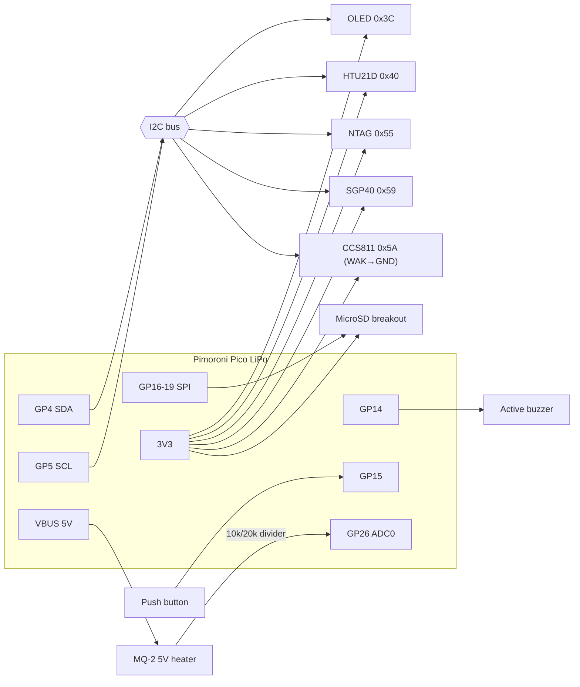

# KUTSU PICO — Hardware

[← KUTSU PICO](README.md) · [Firmware →](FIRMWARE.md)

The original prototype is a **hand-wired protoboard** built around a Pimoroni Pico LiPo and
Adafruit-style breakout modules. There's no custom PCB for this generation. The first PCBs
arrived with [KUTSU DIY](../KUTSU%20DIY/README.md).

---

## Bill of materials

| # | Component | Part no. | Interface | Role |
|---|---|---|---|---|
| 1 | **Pimoroni Pico LiPo** 16 MB | PIM560 | — | RP2040 MCU, USB-C, LiPo charger |
| 2 | **SGP40** air-quality breakout (DFRobot Fermion) | SEN0392 | I²C `0x59` | VOC index |
| 3 | **0.96" I²C OLED** (SSD1306) | CS-ANAVI-DISPLAY-1 | I²C `0x3C` | Display |
| 4 | **HTU21D-F** temp & humidity breakout | Adafruit 1899 | I²C `0x40` | Temperature / RH |
| 5 | **Buzzer** 12 mm, 3 V, 78 dB | CPT-1206-3TH-T | GPIO | Alarm |
| 6 | **NFC I²C NTAG** module (NT3H2111) | NFC-NTAG | I²C `0x55` | Health record |
| 7 | **MicroSD breakout** (SPI/SDIO, 3 V) | Adafruit 4682 | SPI | Logging |
| 8 | **CCS811** air-quality sensor | — | I²C `0x5A` | eCO₂ + TVOC |
| 9 | **MQ-2** gas & smoke module | — | Analog | Combustible gas / smoke |
| 10–14 | Laser diode, red LED, white LED, 2 × push button, on/off switch | — | — | Planned controls / flashlight |
| — | LiPo battery | — | — | Not in the BOM list, but in use |

Supplier and datasheet links are in [`pico-bom.txt`](pico-bom.txt) and
[`prototype-goal.txt`](prototype-goal.txt).

---

## Pinout (`config.py`)

| Function | Pico LiPo pin | Notes |
|---|---|---|
| I²C SDA | **GP4** | STEMMA QT / Qwiic connector |
| I²C SCL | **GP5** | Bus speed **50 kHz** (lowered for a marginal protoboard bus) |
| SD SCK | **GP18** | SPI @ 1 MHz |
| SD MOSI | **GP19** | |
| SD MISO | **GP16** | |
| SD CS | **GP17** | |
| Button | **GP15** | Active-low with internal pull-up. **Also the boot.py "skip remount" pin** |
| Buzzer | **GP14** | Active buzzer driven HIGH/LOW |
| MQ-2 AO | **GP26** (ADC0) | Through a **10 kΩ / 20 kΩ divider** (5 V → ≈ 3.3 V) |

### I²C devices

| Address | Device |
|---|---|
| `0x3C` | SSD1306 OLED |
| `0x40` | HTU21D |
| `0x55` | NT3H2111 NTAG |
| `0x59` | SGP40 |
| `0x5A` | CCS811 (ADD → GND) |

---

## Wiring diagram

---

## Wiring notes

> [!IMPORTANT]
> **CCS811:** tie **WAK → GND**, or the sensor never wakes and initialisation fails.

> [!WARNING]
> **MQ-2:** it's a **5 V** part with a ~150 mA heater, and its analog output can reach 5 V.
> **Always** go through the divider into GP26, because RP2040 pins are 3.3 V only.

- **I²C pull-ups.** Five devices share one bus, and each breakout may carry its own pull-up.
  Measure SDA/SCL to 3V3. If the combined resistance drops below about 2 kΩ, cut the redundant
  pull-up jumpers. If the bus is still flaky, drop `I2C_FREQUENCY` to 25 kHz.
- **SGP40 init order.** The SGP40's timing-sensitive start-up fails when the displayio OLED is
  already active, so the firmware initialises sensors **before** the display.
- **Buzzer.** A low-current active buzzer can go straight to GP14. For higher current, drive it
  through an NPN/MOSFET low-side switch with a flyback diode. The firmware doesn't change.
- **Push button / on-off switch** models are still to be decided; check them against the Pico
  LiPo's own button and switch.

---

## Planned features (from the prototype spec)

These appear in [`kutsu.md`](kutsu.md) but aren't wired or supported in firmware yet:

- Red and white flashlight with a 3-position mode switch
- Red-dot laser on a tactile switch (later built on the KUTSU 1.0 and Handheld PCBs)
- Hardware on/off switch
